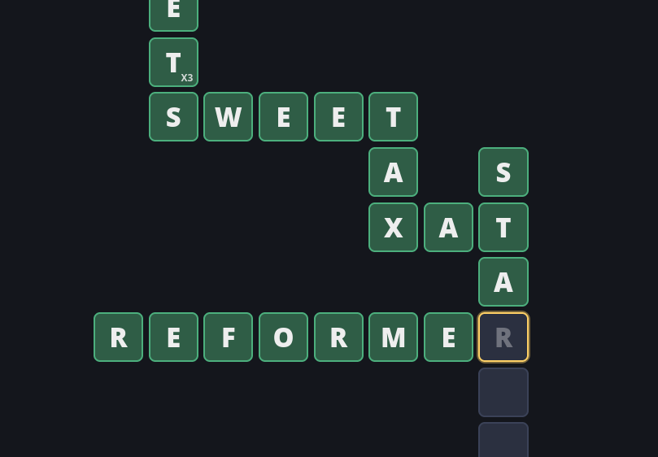

<div align="center">


# Wordwalker

**Type words along a winding path. Never repeat one. Beat the clock.**

[Play it live](https://wordwalker.warze.org/) · [Report a bug](../../issues)



</div>

---

## About

Wordwalker is a fast word game for the browser. A path of empty tiles stretches out in front of you: think of an English word that fits, type it, and the path continues from its last letter, turning a corner each time. Right, then down, then right again. The clock is always ticking, and every valid word buys you more time.

Plain HTML, CSS and JavaScript. No frameworks, no build step, no dependencies.

## How to play

1. Press **Play**. You start with an empty row of 3-6 tiles going **right**.
2. Type a valid English word that fits the row.
3. The next word begins on the last letter of the previous one and goes **down**, then **right**, then **down**, and so on.
4. The inherited letter is shown dimmed until you type it. You still have to type it, and it has to match.
5. If a word is not valid, or you already used it, the tiles flash red. Press **Backspace** and try another.
6. The clock starts when you type your first letter. Keep going until it runs out.
7. Stuck? Tap the 💡 button (bottom right) to reveal a random valid word as faint ghost letters over 5 seconds. You still have to type it. You start with **2 hints** and earn **1 more every 10 words**.

When time is up the camera pans out to show your whole path, followed by your stats: highest scoring word, average score, words used, fastest word and average word time.

### Scoring

- Every letter is worth its **Scrabble value** (E = 1, D = 2, B = 3, K = 5, Q = 10, and so on). The value is shown in the bottom right of the tile once you type the letter. The inherited letter is worth nothing.
- 🟥 **Red** tiles are worth **x2** and 🟪 **purple** tiles are worth **x3**. The multiplier is shown in the bottom left of the tile and applies to that tile's letter, so a Q on a purple tile is worth 30.
- A word's score is the sum of its letters' values after multipliers.
- Each correct word adds **3 seconds + 1.5 seconds per letter** to the clock, up to a maximum of 60 seconds. You start with 30.
- Your best score is saved in your browser.

### Difficulty

The longer you survive, the harder it gets:

- Words get longer: up to 6 letters at first, then 7, 8 and finally 9.
- The shortest allowed word also grows (3, then 4, then 5 letters).
- The inherited letter stops being at the start of the word and can appear in the middle. The tiles then extend backwards (left or up) from the corner.
- Multiplier tiles become more common.

The path never overlaps itself.

## Running locally

The game loads its dictionary with `fetch`, so it has to be served over HTTP. Opening `index.html` directly from disk will not work.

```bash
# with Bun
bun --serve .

# or with Python
python -m http.server 8000
```

Then open the address it prints (for Python: <http://localhost:8000>).

## Browser support

Any modern desktop or mobile browser. Tap the screen on mobile to open the keyboard.

## Author

Made by **WarzeDev** · [GitHub](https://github.com/WarzeDev) · [X / Twitter](https://x.com/warzedev)